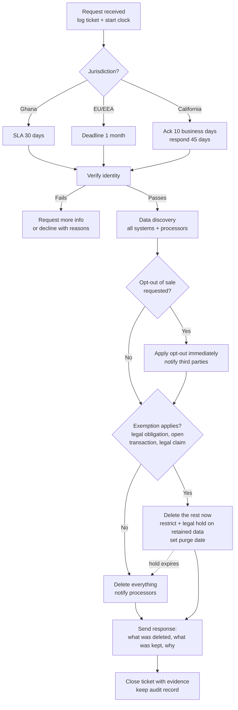

# Multi-Jurisdiction Compliance Response Matrix

| | |
|---|---|
| **Company** | ShopGhana (e-commerce, customers in Ghana, the EU and the US) |
| **Scenario** | Three customers in three jurisdictions submit data deletion requests in the same week |
| **Regulations** | Ghana Data Protection Act, 2012 (Act 843) · EU General Data Protection Regulation (GDPR) · California Consumer Privacy Act as amended by the CPRA (CCPA/CPRA) |
| **Prepared by** | Data Governance & Compliance team |

---

## Executive Summary

| Customer | Jurisdiction | Outcome | Hard deadline | Retained data |
|---|---|---|---|---|
| **Abena** | Ghana (Act 843) | **Delete, keeping some records**: profile and marketing data deleted; financial records kept | No fixed day count ("reasonable time"). **Internal deadline: 30 days** | Invoices, payment and tax records (≈ 6 years) |
| **Lukas** | Germany (GDPR) | **Delete, keeping some records**: erase everything else and tell processors | **1 month** (can extend by 2 more months, with notice) | Invoices and accounting records under German commercial and tax law (8–10 years), restricted to that use only |
| **Maria** | California (CCPA/CPRA) | **Opt-out now, deletion deferred**: stop selling/sharing her data immediately; delete after the return dispute closes | Confirm receipt in **10 business days**; respond in **45 days** (+45 with notice); opt-out in **15 business days** | Order, return and dispute records until the dispute is resolved, then transaction records needed for law |

**Main point:** in all three regimes the right to deletion is *conditional*. ShopGhana must delete what it can, keep only the data a specific legal obligation or ongoing transaction requires, tell the customer exactly what was kept and why, and record the decision for audit.

---

## 1. Customer A: Abena (Ghana, Act 843)

### Legal Rights Analysis

- **Section 33 (correction and deletion):** a data subject may ask the controller to correct, destroy or delete personal data that is inaccurate, irrelevant, excessive, out of date, incomplete, misleading or unlawfully obtained. The controller may also be asked to destroy records it is *no longer authorised to retain*.
- **Section 24 (retention):** personal data must not be kept longer than necessary for the purpose it was collected for, *unless* retention is required or authorised by law, is reasonably necessary for a lawful purpose, or is required by contract.
- **Section 35 (access):** Abena can also ask what data ShopGhana holds about her. Answering this alongside the deletion is good practice.
- **Conclusion:** Abena has a real but **qualified** right to deletion. Once a closed account no longer needs her profile data, ShopGhana is no longer authorised to retain it. Financial records required by law are an exception.

### Exemptions / Lawful Grounds to Retain

| Data | Keep or delete | Legal basis |
|---|---|---|
| Name, email, phone, delivery addresses, saved preferences | **Delete** | Purpose has ended (s.24) |
| Marketing consents, browsing history, wishlist, recommendation profile | **Delete** | Consent withdrawn; no other purpose |
| Saved payment cards / mobile money tokens | **Delete** (ask the payment processor to remove the token) | No continuing purpose |
| Invoices, receipts, payment and VAT records | **Retain** | Revenue Administration Act, 2016 (Act 915), which requires tax records to be kept (6 years) |
| Fraud or chargeback records (if any) | **Retain** for the case only | Lawful purpose / legal claims |

### Company Obligations

1. Confirm Abena's identity before acting (s.35 requires proof of identity for access requests, and the same standard is applied here).
2. Delete the data no longer needed in all systems, including the CRM, marketing platform, analytics and backups (on their normal rotation).
3. Restrict retained records to finance and tax use only.
4. Tell Abena what was done and why anything was kept (s.33).
5. Keep processing secure throughout (s.28) and use only processors bound by contract (s.30).

### Response Deadline

- Act 843 sets **no fixed number of days**. Requests must be handled within a **reasonable time** and changes made **as soon as reasonably practicable**.
- **ShopGhana internal SLA: 30 calendar days.** This matches the GDPR deadline, so one global process covers both.

### Penalties

- The **Data Protection Commission** can issue enforcement notices. Failing to comply with one is a criminal offence (a fine in penalty units, imprisonment, or both).
- Separate offences apply to unregistered processing and unlawful disclosure. Reputational damage in ShopGhana's home market is the larger practical risk.

### Action Steps

1. Log the request (ticket ID, date received, channel).
2. Verify identity using the registered email plus a one-time code.
3. Run a data discovery across all systems to find where Abena's data is held.
4. Delete or anonymise the profile, marketing and analytics data.
5. Flag financial records as *legal hold, finance only, purge after 6 years*.
6. Send the confirmation below and close the ticket with evidence attached.

### Draft Response

> Dear Abena,
>
> Thank you for your request of [date] to delete your personal data. We have verified your identity and completed the request.
>
> **Deleted:** your account profile, contact details, delivery addresses, saved payment methods, marketing preferences and browsing history.
>
> **Retained:** invoices and payment records for your past orders. Ghanaian tax law (Revenue Administration Act, 2016) requires us to keep these for six years. They are stored securely, used only for tax and accounting purposes, and will be deleted automatically when the retention period ends.
>
> You will no longer receive marketing messages from us. If you have questions, contact our Data Protection Supervisor at privacy@shopghana.example. You may also contact the Data Protection Commission of Ghana.
>
> Kind regards,
> ShopGhana Privacy Team

---

## 2. Customer B: Lukas (Germany, GDPR)

### Legal Rights Analysis

- **Article 17 ("right to be forgotten"):** Lukas has a strong right to erasure "without undue delay" where, among other grounds, the data is no longer necessary (Art. 17(1)(a)) or he withdraws consent (Art. 17(1)(b)).
- **Article 12(3):** the controller must act on the request and inform him **within one month** of receipt.
- **Article 19:** ShopGhana must tell every recipient of the data (processors, partners) about the erasure, and tell Lukas who they are if he asks.
- **Article 3(2):** GDPR applies to ShopGhana even though it is based in Ghana, because it offers goods to people in the EU. **Article 27:** ShopGhana needs an EU representative.

### Exemptions (Art. 17(3))

| Exemption | Applies to Lukas? | Data affected |
|---|---|---|
| (b) Legal obligation | **Yes** | Invoices and accounting records: §147 AO and §257 HGB. Accounting vouchers are kept **8 years** (since 1 January 2025); books and annual financial statements **10 years** |
| (e) Establishing, exercising or defending legal claims | Only if a dispute exists (none indicated) | n/a |
| (a) Freedom of expression / (c) public health / (d) archiving or research | No | n/a |

Retained records must be **restricted** (Art. 18). They are kept only to meet the legal obligation and must not be used for marketing, analytics or profiling.

### Company Obligations

1. Verify identity in proportion to the risk, asking for no more data than necessary (Art. 12(6)).
2. Erase personal data in all systems, including processors' systems.
3. Notify processors and recipients (Art. 19), for example the email service, analytics, logistics partner and payment provider.
4. Confirm the outcome to Lukas, listing any retained data and the legal basis for keeping it.
5. Record the request and decision (accountability, Art. 5(2)).

### Response Deadline

- **One month** from receipt (Art. 12(3)).
- This can be extended by **two further months** for complex or numerous requests, but only if Lukas is told about the extension and the reasons **within the first month**.
- There is no fee unless the request is manifestly unfounded or excessive (Art. 12(5)).

### Penalties for Missing the Deadline or Refusing Without Grounds

- Up to **€20 million or 4% of worldwide annual turnover**, whichever is higher (Art. 83(5)(b), infringement of data subject rights).
- Lukas may complain to a German supervisory authority (Art. 77) and claim compensation (Art. 82).

### Action Steps

1. Log the request and start the one-month clock on the day it arrives.
2. Verify identity using the account email and a one-time code.
3. Run a data discovery across ShopGhana's own systems and all processors.
4. Erase or irreversibly anonymise everything except the statutory accounting records.
5. Move invoices to restricted archive storage with automatic deletion after 8 or 10 years.
6. Send Art. 19 erasure notices to processors and collect their confirmations.
7. Send the response below before day 30.

### Draft Response

> Dear Lukas,
>
> We received your erasure request on [date] and have completed it under Article 17 GDPR.
>
> **Erased:** your account, contact details, addresses, order preferences, marketing data and analytics identifiers. We have also told our service providers ([list or "available on request"]) to erase your data, as required by Article 19 GDPR.
>
> **Retained (restricted):** invoices and accounting records for your purchases. German commercial and tax law (§147 AO, §257 HGB) requires us to keep them for up to 10 years. Article 17(3)(b) GDPR allows this. These records are kept only to meet that obligation, are not used for any other purpose, and will be deleted when the retention period ends.
>
> If you disagree with this outcome, you may contact our Data Protection Officer at dpo@shopghana.example or our EU representative at [address]. You may also lodge a complaint with a supervisory authority.
>
> Kind regards,
> ShopGhana Privacy Team

---

## 3. Customer C: Maria (California, CCPA/CPRA)

### Legal Rights Analysis

- **Right to delete:** Cal. Civ. Code §1798.105.
- **Right to opt out of the sale or sharing of personal information:** §1798.120. "Sharing" means cross-context behavioural advertising.
- **Right to know** (§1798.110) and **right to non-discrimination** (§1798.125). Maria cannot be penalised for using her rights.

### Can Deletion Be Immediate?

**No, not in full.** Maria has an **active return dispute**. Under §1798.105(d), a business may keep personal information it needs to:

- **(d)(1)** complete the transaction the data was collected for, provide goods the consumer requested, or perform a contract with the consumer. The open return is part of that transaction.
- **(d)(8)** comply with a legal obligation, such as keeping records of the transaction.
- Defend legal claims (§1798.145(a)(1)(E)), if the dispute escalates.

So ShopGhana should **delete now** the data the dispute does not need (marketing profile, browsing history, advertising identifiers) and **defer** deleting the order, return and dispute records until the dispute closes. The **opt-out has no exception and must be honoured immediately.**

### Company Obligations

1. **Opt-out:** stop selling or sharing Maria's data within **15 business days** (CCPA Regulations §7026), and tell third parties who received it in the last 90 days to stop. Honour Global Privacy Control signals.
2. **Deletion:** confirm receipt within **10 business days** (Regs. §7021) and respond within **45 calendar days**.
3. For the deferred part, explain what is kept and why. Use those records **only** for the dispute.
4. Tell service providers, contractors and third parties to delete her data (§1798.105(c)).
5. Keep a record of the request and response for **24 months** (Regs. §7101).

### Response Deadline

| Step | Deadline |
|---|---|
| Confirm receipt of the deletion request | 10 business days |
| Honour the opt-out of sale/sharing | As soon as feasible, no later than 15 business days |
| Substantive response to the deletion request | 45 calendar days |
| Extension | Once, by a further 45 days (90 total), if Maria is told within the first 45 days |

### Required Disclosures

- The categories of personal information ShopGhana collects, why it collects them, and who it sells or shares them with (privacy policy, §1798.100 and §1798.110).
- Confirmation that the opt-out is in effect.
- Which data is deleted now, which is kept, the specific exception relied on, and when the rest will be deleted.
- How to appeal or ask questions.

### Penalties

- Administrative fines from the **California Privacy Protection Agency (CPPA)** or civil penalties from the Attorney General: up to **$2,500 per violation**, or **$7,500 per intentional violation** or violation involving a minor. Since 2025 these are adjusted for inflation to $2,663 and $7,988.
- Data breaches caused by poor security also carry a private right of action (statutory damages per consumer per incident).

### Action Steps

1. Log both requests (deletion and opt-out) on the day they arrive.
2. **Day 0–2:** apply the "Do Not Sell or Share" flag, remove Maria from advertising audiences and partner data feeds, and notify third parties.
3. **Within 10 business days:** send the acknowledgement and verify identity (match two data points from the account).
4. Delete the data not needed for the dispute.
5. Put a legal hold on the order, return and dispute records, linked to the dispute ticket.
6. **Within 45 days:** send the response below.
7. **When the dispute closes:** delete the remaining data except the transaction records the law requires, notify Maria, and close the ticket.

### Draft Response

> Dear Maria,
>
> We received your requests of [date] and want to tell you how we have handled them.
>
> **Opt-out of sale/sharing: complete.** We have stopped selling or sharing your personal information and have told our partners to do the same.
>
> **Deletion: partly complete.** We have deleted your marketing profile, browsing history and advertising identifiers. Your return for order #[number] is still open. California law (Cal. Civ. Code §1798.105(d)) allows us to keep the order, return and payment details we need to resolve it. We will use this information only to resolve your return. Once the return is resolved, we will delete it, except for transaction records we must keep by law, and we will write to confirm.
>
> Using these rights will not affect the price or service you receive from us. If you have questions or wish to appeal this decision, contact privacy@shopghana.example.
>
> Kind regards,
> ShopGhana Privacy Team

---

## 4. Compliance Comparison Table

| Element | Ghana DPA (Act 843) | GDPR | CCPA/CPRA |
|---|---|---|---|
| **Right to deletion?** | Yes, qualified (s.33, with s.24 retention limits) | Yes, strong (Art. 17) | Yes (§1798.105) |
| **Main exemptions** | Retention required or authorised by law; lawful purpose; contract | Legal obligation; legal claims; free expression; public interest / health; archiving and research | Complete the transaction or contract; security and fraud; legal obligation; legal claims; internal uses the consumer would expect; free speech; research |
| **Response deadline** | "Reasonable time" / "as soon as reasonably practicable" (internal SLA: 30 days) | 1 month (+2 months with notice) | Acknowledge in 10 business days; respond in 45 days (+45 with notice) |
| **Third-party notification** | Processors bound by contract (s.30) | Required, Art. 19 | Required: service providers, contractors and third parties (§1798.105(c)) |
| **Identity verification** | Proof of identity (s.35) | Reasonable, proportionate (Art. 12(6)) | "Verifiable consumer request" (Regs. §§7060–7062) |
| **Regulator** | Data Protection Commission | National supervisory authorities (in Germany, the federal BfDI and the state authorities) | California Privacy Protection Agency; Attorney General |
| **Penalties** | Enforcement notices; criminal fines (penalty units) and/or imprisonment | Up to €20M or 4% of global turnover | $2,500 / $7,500 per violation (inflation-adjusted to $2,663 / $7,988) |
| **Consent model** | Consent or another lawful basis (s.20) | Consent must be freely given, specific, informed and unambiguous, or another Art. 6 basis must apply | Mainly opt-out (sale/sharing); opt-in for consumers under 16 |
| **Record-keeping** | Accountability (s.17) | Accountability (Art. 5(2)) and records of processing (Art. 30) | Keep request records for 24 months (Regs. §7101) |

---

## 5. Unified Deletion Workflow

One process covers all three regimes. It is built around the **strictest deadline that applies** to each request.

### Audit Log Template

| Field | Abena | Lukas | Maria |
|---|---|---|---|
| Ticket ID | DSR-GH-001 | DSR-EU-002 | DSR-CA-003 |
| Received | [date] | [date] | [date] |
| Regime | Act 843 | GDPR | CCPA/CPRA |
| Deadline | +30 days (internal) | +1 month | Ack +10 bd; response +45 days; opt-out +15 bd |
| Identity verified | Email + OTP | Email + OTP | Two-point match |
| Deleted | Profile, marketing, analytics, payment tokens | Everything except accounting records | Marketing, browsing, ad IDs |
| Retained and why | Tax records, Act 915 (6 yrs) | Accounting records, AO/HGB (8–10 yrs) | Order/return records, §1798.105(d)(1) until dispute closes |
| Third parties notified | Payment processor, email provider | All processors (Art. 19) | Service providers + ad partners |
| Response sent | [date] | [date] | [date]; follow-up after dispute |
| Purge date for retained data | [date + 6 yrs] | [date + 8/10 yrs] | Dispute close + statutory period |

---

## 6. Key Insights

- **GDPR is the strictest** on timing (a fixed one-month deadline), on duties towards third parties (Art. 19), and on penalties. It also applies to ShopGhana outside the EU (Art. 3(2)).
- **CCPA/CPRA is built around consumer control.** The opt-out of sale/sharing has *no* exceptions and its own short deadline, separate from the deletion timeline.
- **Ghana's Act 843** gives real rights but uses open standards ("reasonable time"). An internal 30-day SLA makes ShopGhana's home-market practice defensible and consistent with its EU obligations.
- **Deletion is never all-or-nothing.** All three customers end up with *partial* deletion. Compliance depends on doing that well: tightly scoped retention, use limited to the retention purpose, automatic purge dates, and clear communication.
- **Data mapping comes first.** ShopGhana cannot meet any of these deadlines unless it knows every system and processor that holds customer data.

## 7. Recommendations for ShopGhana

1. **Use one global deletion process** with jurisdiction-specific clocks, so the strictest applicable rule always wins.
2. **Keep a live data inventory** (records of processing) covering every system and processor.
3. **Automate retention.** Tag records with a legal basis and purge date, and delete them automatically when the date passes.
4. **Separate the opt-out pipeline** so that sale/sharing stops within hours, not days.
5. **Appoint an EU representative** (GDPR Art. 27), **register with Ghana's Data Protection Commission**, and keep the California privacy notice up to date.
6. **Train support staff** to recognise privacy requests in any channel (email, chat, social media) and route them to the privacy team on the day they arrive.

## Conclusion

ShopGhana must handle each request under the law of the customer's jurisdiction, balancing each customer's rights against its own legal obligations. In this scenario that means:

- deleting Abena's data except her tax records;
- erasing Lukas's data within one month and notifying every processor;
- stopping the sale of Maria's data immediately while lawfully deferring deletion until her return dispute is resolved.

Clear identity verification, tightly scoped retention, honest communication and a full audit record let ShopGhana show it complies in all three jurisdictions and keep customers' trust.

---

*This matrix is an academic compliance exercise and not legal advice. Statutory references reflect the law as understood at the time of writing. Check them with qualified counsel before relying on them in production.*
